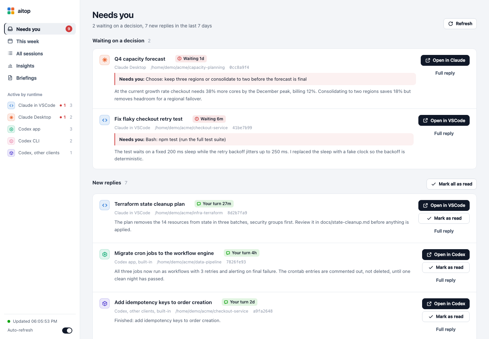
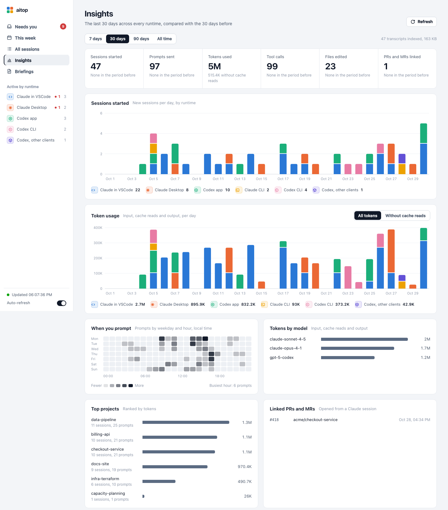
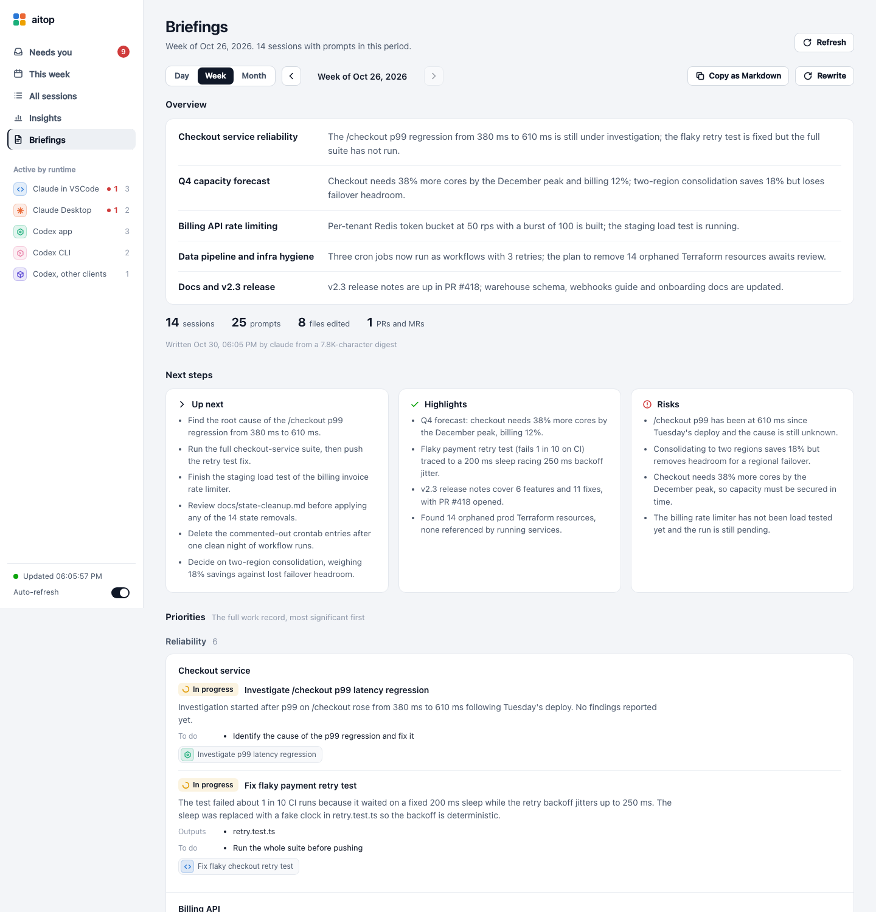

# aitop

`aitop` shows every AI coding-agent session on your machine in one place and tells you which ones are waiting on you.

Claude Code and Codex each keep their sessions in their own stores, and every client shows only a slice. The VSCode panel lists the current folder's sessions, the desktop apps list their own, and Codex hides threads that ran on a different model provider. `aitop` reads all of those stores directly and merges them. It is a single Python file with no dependencies.



The screenshots in this README come from the bundled demo data, so every name in them is made up.

## What it covers

| Runtime | Source |
| --- | --- |
| Claude Code in VSCode, the CLI, and the Claude Desktop Code tab | `$CLAUDE_CONFIG_DIR/projects/*/*.jsonl` transcripts, plus `$CLAUDE_CONFIG_DIR/sessions/<pid>.json` for live status |
| Claude Desktop session titles, archive flags and turn summaries | `~/Library/Application Support/Claude/claude-code-sessions/` (macOS) |
| Codex app, CLI, IDE extension and Chrome side panel, across all model providers | `$CODEX_HOME/state_*.sqlite` plus rollout files |

Each session gets one status:

- **waiting**: blocked on you. A permission prompt, a question, or a turn that ended asking for a decision.
- **running**: the agent is working.
- **your-turn**: the turn finished and a reply is ready.
- **closed**: no process has the session open.
- **archived**: archived in its app.

A session whose files can't be parsed still appears, marked "Could not read this session" with the error, so one damaged transcript never hides the others.

## Requirements

- Python 3.9 or newer, including the Python that ships with macOS. Only the standard library is used.
- macOS is the main target. On Linux the session list, portal, insights and briefings work. Jumping into Claude Desktop and Codex sessions, and opening a terminal, depend on macOS apps and URL handlers.
- Briefings use the `claude` CLI by default, which needs a version that supports `--no-session-persistence` and `--tools` (tested with 2.1.299 and 2.1.310).

## Install

```sh
curl -o ~/.local/bin/aitop https://raw.githubusercontent.com/arthaszyb/aitop/main/aitop
chmod +x ~/.local/bin/aitop
```

Any directory on your `PATH` works.

## Command line

```sh
aitop                        # live sessions plus anything active in the last 7 days
aitop list --all             # include closed and archived sessions
aitop list --all --since 3d  # everything active in the last 3 days
aitop list --runtime codex   # filter by runtime prefix
aitop catchup                # sessions waiting on you, with the agent's latest reply
aitop show <id-prefix>       # your last prompt and the full reply; marks it read
aitop ack <id-prefix> | --all
aitop week                   # sessions started this week, and older ones picked up again
aitop brief weekly           # work briefing for this week, as Markdown (daily | weekly | monthly)
aitop serve                  # web portal on http://127.0.0.1:8765/
aitop --version
```

## Portal

`aitop serve` starts a local web app with five views.

- **Needs you** lists blocked sessions first, then new replies, each with a preview of the reply.
- **This week** splits sessions started this week from older sessions that were active again.
- **All sessions** is a searchable table with runtime and status filters.
- **Insights** shows sessions started, prompts, token use by runtime and by model, a weekday-by-hour activity heatmap, top projects, and linked pull or merge requests, for the last 7, 30 or 90 days or all time.
- **Briefings** writes daily, weekly or monthly work reports, described below.



Each runtime has its own icon and color. Clicking a session title opens the session where it lives:

| Runtime | How it opens |
| --- | --- |
| VSCode | The extension's `vscode://anthropic.claude-code/open?session=<id>` handler |
| Claude Desktop | `claude://code/continue?session=<id>` |
| Codex | `codex://threads/<id>` |
| CLI | A live session brings its terminal app to the front. A closed one opens a new Ghostty or Terminal window running the resume command. |

The first time the portal opens a terminal window, macOS asks you to allow the automation.

## Briefings

A briefing collects every session with a prompt in the chosen day, week or month. For each session it takes the prompts you sent and the agent's final reply to each, trims them to a size budget, and asks an LLM to write the report in three parts:

- **Overview**: 3 to 5 points on the period's main areas of work and where each stands.
- **Next steps**: the actions to take next, the highlights, and the risks.
- **Priorities**: the full record, grouped by category, project and task and ordered by importance. Each task has its progress, a short summary, the outputs it produced, the to-dos still open, and the sessions it came from.

Personal sessions are left out, and so are sessions that cannot be read; the briefing names the latter. Briefings are cached under `$XDG_CACHE_HOME/aitop/briefs/`, and the portal can copy them as Markdown.

By default the LLM call is `claude -p --no-session-persistence --tools "" --strict-mcp-config`. That runs one headless, tool-less turn with your existing Claude Code login and does not save a session of its own. You can point it at any command that reads a prompt on stdin and prints JSON.



## Configuration

Settings are optional and live in `$XDG_CONFIG_HOME/aitop/config.json`, which defaults to `~/.config/aitop/config.json`:

```json
{
  "brief": {
    "language": "English",
    "categories": ["Feature development", "Reliability", "Efficiency", "Security", "Research", "Other"],
    "command": ["claude", "-p", "--no-session-persistence", "--tools", "", "--strict-mcp-config"],
    "timeout": 900,
    "digest_chars": 160000
  }
}
```

These environment variables are honoured:

| Variable | Used for | Default |
| --- | --- | --- |
| `CLAUDE_CONFIG_DIR` | Claude Code data | `~/.claude` |
| `CODEX_HOME` | Codex data | `~/.codex` |
| `AITOP_CLAUDE_DESKTOP_DIR` | Claude Desktop session metadata | `~/Library/Application Support/Claude/claude-code-sessions` |
| `XDG_CONFIG_HOME` | the config file | `~/.config` |
| `XDG_STATE_HOME` | read marks | `~/.local/state` |
| `XDG_CACHE_HOME` | usage index and briefings | `~/.cache` |

## Demo data and tests

`demo/make_demo.py` writes a fictional Claude Code and Codex environment, with live sessions in every state, Claude Desktop sessions, two Codex providers and four weeks of history. It prints the environment variables that point `aitop` at it:

```sh
python3 demo/make_demo.py /tmp/aitop-demo
# then run the printed export line, and:
aitop serve
```

`tests/smoke_test.py` builds that demo in a temporary directory, adds a damaged transcript, and runs every command and portal route against it with the Python that runs the test. It never touches your real session data.

```sh
python3 tests/smoke_test.py
/usr/bin/python3 tests/smoke_test.py   # macOS's built-in Python
```

## Privacy and safety

- `aitop` only reads the agents' stores. It writes its own read marks, a usage index and generated briefings, and nothing else.
- The usage index keeps per-day token and activity counts. When an agent's transcripts are deleted, the counts stay, so the history survives cleanups.
- The portal listens on 127.0.0.1 only. It rejects requests whose `Host` header is not its own address, which blocks DNS-rebinding attacks. State-changing requests must be JSON, so other websites cannot trigger them.
- Briefings are the only feature that sends session content anywhere. They send a digest to the LLM command you configure, which by default is the same Claude Code login your sessions already use.

## Limitations

- The session stores are internal formats of Claude Code and Codex, not public APIs. A client update can change them, and the affected fields show up as errors, not silently wrong data.
- Codex does not record approval prompts on disk, so a Codex session paused on an approval shows as `running` or `your-turn`.
- No public interface can send a prompt into a session another app has open, so `aitop` does not send prompts.

## License

MIT
